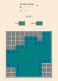

## Hi there! 👋

### I'm Dmitry, a Frontend Engineer (React, TypeScript) 🚀

- Nearly 3 years of commercial frontend experience in remote, cross-functional product teams
- Most recently, main frontend contributor on a social network and marketplace for watch collectors (NDA): real-time chat, auctions, subscriptions
- AI-assisted, human-reviewed development: custom Claude Code skills, MCP integrations with Jira and Figma, shared AI rules for the team
- 11 years as a technical translator and interpreter before engineering, 4 of them leading a group of 11. English: C1
- Open to remote full-time or contractor roles

#### Contacts
[Email](mailto:dimikh.work@gmail.com) · [Telegram](https://t.me/m5production86) · [Resume (PDF)](resume/Dmitry_Mikheev_Frontend_Engineer.pdf)

#### Skills

#### Projects

**[Clone-Kahoot](https://github.com/m5production/clone-kahoot)** · [demo](https://dimetriyo.github.io/clone-kahoot/) · [backend](https://github.com/m5production/clone-kahoot-backend)

Full-stack real-time quiz game: the host builds a quiz and runs it live, players join and answer in real time.  
**Stack**: React, TypeScript, Vite, TanStack Query, React Hook Form, Tailwind CSS, shadcn/ui · Node.js, Express, WebSocket (ws), Prisma, SQLite, Docker

**[E-commerce app](https://github.com/mamont79/eCommerce-Application)**

SPA built in a team of 3: catalog, product pages, forms.  
**Stack**: React, Redux, React Router 6, TypeScript, Vite, Formik, Axios, Styled Components, Vitest, Husky

**[Pokémon memo game](https://github.com/m5production/pokemon-memo-game)**

Memory card game with animations.  
**Stack**: React, Redux, TypeScript, Vite

**[Minesweeper](https://github.com/m5production/Minesweeper)**

Classic game on vanilla TypeScript with self-made class-based components.  
**Stack**: TypeScript, Webpack

#### Certificates
[RS School — JavaScript/Front-end](https://app.rs.school/certificate/yo4ro8ii)
